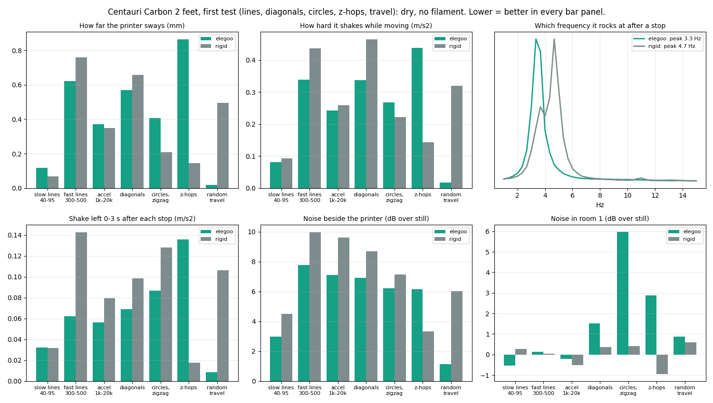
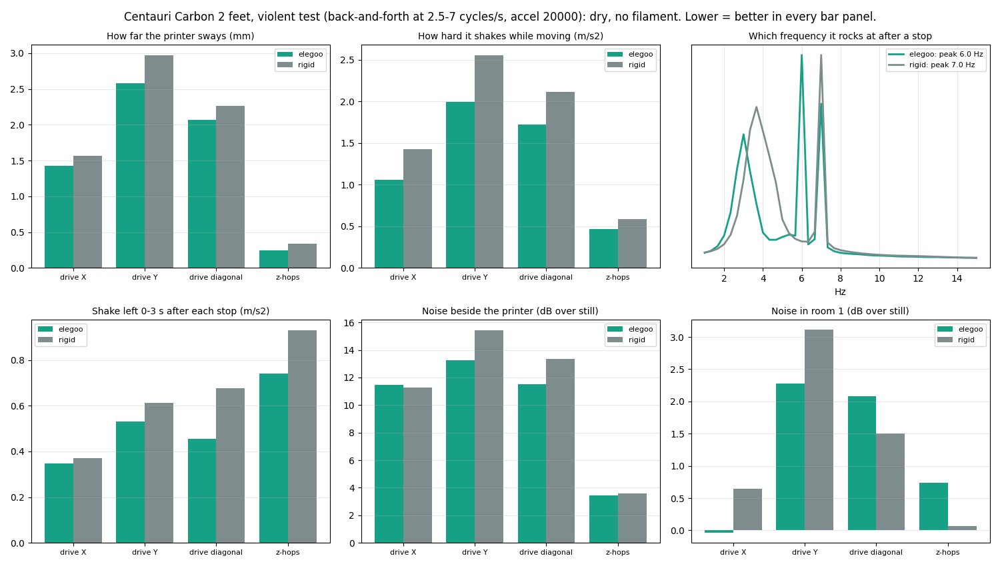

# CC2 feet: printed rigid feet vs Elegoo anti-vibration feet (tested 2026-10-18)

The rigid foot: a solid PLA+ cup, 40 mm across x 18 mm, 32 mm bore 13 mm
deep that slips over the stock foot (interface from Printables 1579825).
Older notes on it: git history of this file.

## Result: the soft feet won

After Reddit replies said soft feet are there for a reason, I ran the same dry
head-move tests (no heat, no filament) on my rigid feet and on Elegoo's
anti-vibration feet. Phones: one taped on top of the printer (acceleration),
one beside it and one in the next room (sound). Printer on a stone slab that
sits on 9 half tennis balls. Dry head moves only: print quality was not compared.

Everyday moves (lines 40-500 mm/s, accel 1000-20000, diagonals, circles,
zigzag, z-hops, random travel):

Violent test (back-and-forth at 2.5-7 cycles per second, accel 20000, the
printer's own rocking range; on the Elegoo feet it shook hard enough to look
alarming):

| | Elegoo AV feet | Rigid PLA feet |
|---|---|---|
| Violent: sway | 1.75 mm | 1.92 mm |
| Violent: shake while moving | 1.39 m/s2 | 1.77 m/s2 |
| Violent: shake left after stops | 0.49 m/s2 | 0.64 m/s2 |
| Everyday: sway | 0.41 mm | 0.35 mm |
| Everyday: shake left after stops | 0.06 m/s2 | 0.10 m/s2 |
| Rocking frequency after a stop | 3.3 Hz | 4.7 Hz |
| Noise beside / next room | within 1 dB | within 1 dB |

- The rigid feet do not stop the rocking: they raise its frequency
  (3.3 -> 4.7 Hz) and the printer shakes harder when driven there. The 3-5 Hz
  rock is printer + slab swaying on the tennis balls; the feet only shift it.
- Elegoo's feet shake ~20% less under the violent test and settle faster after
  every stop; on everyday moves it is a draw.
- Noise: no measurable difference.
- My pick now is Elegoo's feet. An earlier measurement (2026-09-30, slab on
  the floor on 12 half tennis balls) had the rigid feet moving the sway from
  about 6.5 Hz to about 19 Hz; on the current setup (new slab, 9 balls) that
  did not hold.
- Re-run input shaping after any foot change (`find-your-numbers.md`).
